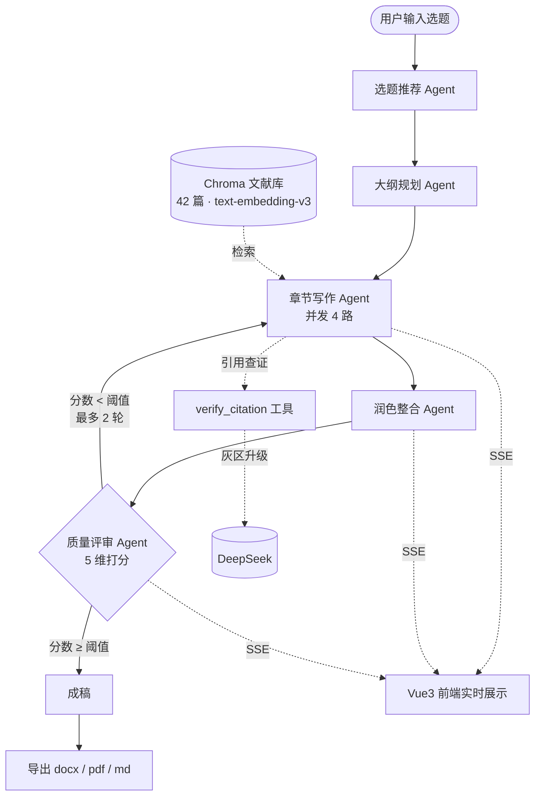

# AI 论文写作系统

> 输入一个选题，自动产出结构完整、有文献支撑、经过质量评审的中文论文 —— 并支持 Word / PDF / Markdown 导出。

[](https://www.python.org/)
[](https://fastapi.tiangolo.com/)
[](https://vuejs.org/)
[](https://langchain-ai.github.io/langgraph/)
[](docker-compose.yml)
[](backend/tests)
[](LICENSE)

---

## 这个项目解决什么

让大模型写论文不难，难的是**让它写得像论文**：结构要对、引用要能查、质量要能评、成本要能算、出错不许假装没事。

本项目把这件事拆成一条可观测的流水线：选题 → 大纲 → 分章写作（并发）→ 文献检索与引用查证 → 多维评审 → 不达标自动重写 → 导出。每一步都有结构化输出、降级策略和量化指标，而不是「调一次 API 把结果丢给前端」。

## 核心特性

| | 特性 | 说明 |
|---|---|---|
| 🧠 | **多 Agent 流水线** | 选题推荐 → 大纲规划 → 章节写作 → 润色 → 质量评审，LangGraph 编排，状态可追溯 |
| 🔁 | **评审驱动重写** | 5 维评分（结构 / 内容 / 论证 / 引用 / 表达）+ 必须修改项，低于阈值自动重写，最多 2 轮 |
| 📚 | **RAG 文献增强** | 内置 42 篇学术文献向量库，写作时检索引用；引用编号与文末条目同源 |
| 🔍 | **引用查证工具** | 先做 embedding 余弦 + 关键词重合的确定性初筛，只在灰区升级 LLM 裁决，约 80% 查证零模型往返 |
| ⚡ | **并发写作** | 章节独立并发（默认 4 路），结果按大纲下标回填保证成文顺序；同条件端到端耗时 −37% |
| 📡 | **SSE 流式进度** | 生成过程实时推送节点进度与正文片段，前端逐段渲染，长任务不再「转圈到死」 |
| 🎯 | **结构化输出** | Pydantic Schema 作为出口契约，三级降级（function calling → JSON mode → 裸文本），全失败显式报错 |
| 💰 | **成本可核算** | 按节点 / 论文 / 用户记录 token、缓存命中、峰谷价与金额，单篇成本可查（实测 0.086 元） |
| 🧪 | **演示模式** | `DEMO_MODE=true` 无 Key、零外呼跑通全链路，公网 Demo 不烧钱 |
| 📦 | **一条命令部署** | 多阶段镜像 + compose + 命名卷，非 root 运行，PDF 中文字体内置 |

## 系统架构



**技术栈**

| 层级 | 选型 |
|---|---|
| 后端 | FastAPI · SQLAlchemy 2.0 · SQLite · LangGraph · LangChain · Chroma |
| 模型 | DeepSeek（OpenAI 兼容接口）· 阿里云百炼 `text-embedding-v3` |
| 前端 | Vue 3 · Vite · Vue Router · Axios |
| 交付 | Docker 多阶段构建 · docker compose · Nginx（SSE 不缓冲反代） |
| 质量 | pytest · pytest-asyncio · httpx · 端到端评测脚本 |

---

## 快速开始

### 方式一：Docker（推荐，一条命令）

```bash
git clone https://github.com/CWF6868/ai-paper-writer.git
cd ai-paper-writer

# 默认演示模式：不调用任何外部模型，无需 API Key，不产生费用
docker compose up -d --build
```

打开 <http://localhost:8080>，用演示账号登录即可体验完整流程（注册、生成、SSE 进度、导出）。

> 首次构建约 3–5 分钟。国内网络建议指定镜像源：
> ```bash
> APT_MIRROR=http://mirrors.aliyun.com \
> PIP_INDEX_URL=https://mirrors.aliyun.com/pypi/simple \
> NPM_REGISTRY=https://registry.npmmirror.com \
> docker compose build
> ```

**接入真实模型**（会产生 API 费用）：

```bash
DEMO_MODE=false \
DEEPSEEK_API_KEY=sk-xxx \
DASHSCOPE_API_KEY=sk-xxx \
docker compose up -d
```

| 命令 | 作用 |
|---|---|
| `docker compose logs -f backend` | 查看后端日志 |
| `docker compose down` | 停止服务（数据保留在命名卷中） |
| `docker compose down -v` | 停止并清空数据（演示环境重置） |

### 方式二：本地开发

**后端**

```bash
cd backend
python -m venv venv
source venv/bin/activate        # Windows: venv\Scripts\activate
pip install -r requirements.txt

cp .env.example .env            # 填入 DEEPSEEK_API_KEY / DASHSCOPE_API_KEY
uvicorn app.main:app --reload --port 8000
```

首次启动自动建表；首次使用 RAG 需灌入文献向量库（仅一次）：

```bash
python seed_rag.py              # 42 篇语料 → Chroma，完成后重启后端
```

接口文档：<http://127.0.0.1:8000/docs>

**前端**

```bash
cd frontend
npm install
npm run dev                     # http://localhost:5173，/api 自动代理到 8000
```

Windows 用户也可直接双击根目录的 `start-all.bat`，一键拉起前后端两个窗口。

### 配置项

配置集中在 `backend/.env`（模板见 [`backend/.env.example`](backend/.env.example)）：

| 变量 | 默认值 | 说明 |
|---|---|---|
| `DEEPSEEK_API_KEY` | — | 写作与评审模型密钥 |
| `DASHSCOPE_API_KEY` | — | 文献向量化密钥 |
| `DEMO_MODE` | `false` | `true` 时全部外呼替换为本地确定性实现 |
| `DEMO_SEED_ON_START` | `true` | 启动时幂等准备演示数据（42 篇语料 + 样例论文） |
| `DATABASE_URL` | `sqlite:///./paper_writer.db` | 数据库连接串 |
| `VECTOR_DB_PATH` | `./data/chroma` | Chroma 持久化路径 |
| `SECRET_KEY` | — | JWT 签名密钥，**生产必须更换** |
| `SECTION_CONCURRENCY` | `4` | 单篇内章节并发上限 |
| `LLM_MAX_TOKENS` | `8192` | 输出上限（评审长文本易被 4096 截断） |
| `QUALITY_PASS_THRESHOLD` | `0.44` | 评审通过线，低于则重写 |
| `PDF_CJK_FONT` | 自动探测 | 显式指定 PDF 中文字体路径 |

---

## API 一览

| 模块 | 端点 | 说明 |
|---|---|---|
| 认证 | `POST /api/auth/register` · `POST /api/auth/login` · `GET /api/auth/me` | 注册 / 登录 / 当前用户 |
| 论文 | `GET/POST /api/papers` · `GET/PUT/DELETE /api/papers/{id}` | CRUD、搜索、状态筛选、分页 |
| 生成 | `POST /api/papers/{id}/stream-generate` | **SSE 流式生成（推荐）** |
| 生成 | `POST /api/papers/{id}/generate` | 同步生成 |
| 导出 | `GET /api/papers/{id}/export?format=docx\|pdf\|md` | 多格式导出 |
| 选题 | `POST /api/topics/recommend` | 选题推荐 |
| 成本 | `GET /api/metrics/llm?days=7&node=&user_id=` | token / 成本 / 延迟聚合 |
| 健康 | `GET /api/health` | 容器与探活专用（返回 `demo_mode`） |

论文数据按用户隔离；成本接口普通用户仅可见自己的记录。

---

## 工程亮点（有数，不吹）

这条流水线的每一处优化都留下了可复现的测量，而不是「感觉快了」。

| 指标 | 结果 | 口径 |
|---|---|---|
| 单篇生成耗时 | **129.3s**（同条件 205.3s → −37.0%） | 同一题目、同样 2 轮重写 |
| 章节写作段 | **2.0s / 8 章**（并发 4） | 串行 8.0s，4.00× |
| 单机吞吐 | **11.64 篇/分**（论文并发 1） | 2.18× |
| 单篇成本 | **0.0863 元** | 真实 DeepSeek，18 次调用 / 40.7k token |
| 缓存节省 | 成本的 **13.8%** | 缓存命中 8,192 token（28.8%） |
| 成本计量覆盖率 | **100%**（22/22） | 独立计数源对账 |
| 检索质量 | Recall@1 **85.2%**，MRR **0.926** | 42 篇固定语料，top_k=5 |
| 引用可溯源率 | **30/30** | 6 篇成稿的参考文献条目 |
| 测试 | **358 passed**，覆盖率 **93%** | `pytest`，含并发/降级/预算/SSE 回归 |
| 镜像体积 | backend **1.01GB** / frontend **73.9MB** | 冷启动 7s 到 healthy |

设计细节与踩坑记录（含失败结论）：
[结构化输出与工具调用](docs/P0-1-结构化输出与工具调用设计.md) ·
[并发与异步化](docs/P0-2-并发与异步化设计.md) ·
[LLM 成本治理](docs/P0-3-LLM成本治理设计.md) ·
[容器化与交付](docs/P0-4-容器化与交付设计.md)

> 一处如实记录：把评审通过线从硬编码 `0.7` 调到 `0.44`，不是因为「更容易过」，而是实测首检分中位数就是 0.44、标准差仅 0.026 —— 0.7 会让 100% 的论文都触发重写，门禁形同虚设；0.44 让 33% 触发，质量差异落在评分噪声带内。这个数字由 `scripts/analyze_threshold.py` 按实测数据推演得出，可复跑。

---

## 项目结构

```
ai-paper-writer/
├── backend/
│   ├── app/
│   │   ├── agents/          # 选题 / 大纲 / 写作 / 润色 / 评审 / 参考文献 Agent
│   │   ├── workflows/       # LangGraph 编排、状态定义、节点埋点
│   │   ├── llm/             # Schema 契约、三级降级、工具（引用查证 / 语料检索）
│   │   ├── rag/             # 42 篇语料、embedding、Chroma 向量库、检索器
│   │   ├── api/             # auth / papers / topics / export / metrics
│   │   ├── core/            # 计价客户端、日志落库、安全、依赖
│   │   ├── models/ schemas/ # ORM 与 Pydantic 模型
│   │   ├── demo/            # 演示模式：确定性模型替身与种子数据
│   │   └── main.py          # 入口（lifespan 建表 / 初始化向量库）
│   ├── tests/               # 26 个测试文件，358 个用例
│   ├── scripts/             # 评测、压测、阈值标定、成本账单、冒烟
│   ├── seed_rag.py          # 灌入文献向量库
│   ├── Dockerfile           # 多阶段构建，非 root，内置中文字体
│   └── requirements.txt
├── frontend/
│   └── src/
│       ├── views/           # 登录 / 论文列表 / 论文详情
│       ├── components/      # 编辑弹窗等
│       ├── api/             # Axios 封装（相对路径 /api）
│       └── router/
├── docs/                    # 四份设计文档（含验收证据与失败复盘）
├── docker-compose.yml       # 前后端 + 命名卷 + healthcheck
└── start-all.bat            # Windows 一键启动
```

## 测试与评测

```bash
cd backend
pip install -r requirements-dev.txt
pytest -q                                    # 358 passed
pytest --cov=app --cov-report=term-missing   # 覆盖率明细
```

仓库内保留了可复跑的评测脚本（`backend/scripts/`）：

| 脚本 | 用途 |
|---|---|
| `eval_generate.py` | 端到端批量生成，输出质量分与耗时 JSON |
| `eval_one.py <id>` | 单篇补跑，失败不必整轮重来 |
| `bench_concurrency.py` | 并发压测（stub 模型，不耗额度） |
| `report_llm_cost.py` | 真实生成并输出成本账单 |
| `analyze_threshold.py` | 按实测分布推演重写率与平均质量 |
| `probe_score_spread.py` | 评分区分度探针（好稿 vs 空洞稿） |
| `smoke_demo.py` | 演示模式全链路冒烟（可指定 base url） |

## 已知限制

- **学术诚信**：本项目是写作辅助工具，产出必须经人工核验与改写，不可直接作为学术成果提交。
- **文献库规模**：内置 42 篇语料用于演示检索链路，覆盖面有限，真实场景应替换为自建语料。
- **评审分数是相对量**：同一流水线、同一模板产出的论文质量本就接近，分数集中在 0.42–0.52 属正常，不代表评分失效。
- **SQLite 单机**：适合演示与个人使用；多用户生产环境建议替换为 PostgreSQL。
- **中文优先**：Prompt、评审维度与 PDF 字体适配均以中文论文为设计目标。

## Roadmap

- [x] 多 Agent 编排与流式生成
- [x] RAG 检索 + 引用查证工具
- [x] 结构化输出与三级降级
- [x] 章节并发与异步化
- [x] LLM 成本归因与账单
- [x] 容器化一条命令部署 + 演示模式
- [ ] CI（测试 / 镜像 / 评测回归）
- [ ] 公网 Demo 部署
- [ ] 自建语料上传与多文献库切换
- [ ] PostgreSQL 支持与多租户

## License

[MIT](LICENSE)
